# MacVisualiser

A real-time music visualizer for macOS that reacts to **whatever your Mac is playing**: Spotify, Apple Music, YouTube in a browser, games, anything. No virtual audio driver, no setup, nothing to route.

11 GPU-rendered scenes react to bass, mids, treble and beats. On top of every scene you can add trails, a kaleidoscope, bloom, beat flashes and more, all from a control panel.

<p align="center">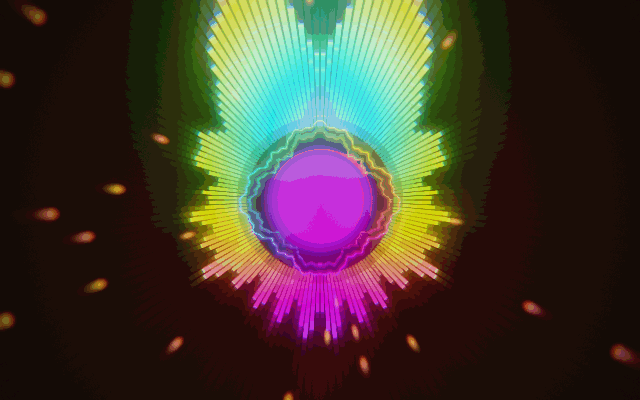</p>

## Download

Grab `Visualizer-1.1-macOS.zip` from [**Releases**](https://github.com/SeifAteek/MacVisualiser/releases/latest), unzip it, and move `Visualizer.app` to Applications.

The app isn't notarized, so macOS blocks it the first time. **Right-click → Open** once, or run:

```bash
xattr -cr /Applications/Visualizer.app
```

Requires **macOS 14.4 or later** on **Apple Silicon**.

### Permission

On first launch macOS asks to let Visualizer record system audio. Allow it. If the meters in the panel stay flat while music plays, turn it on in **System Settings → Privacy & Security → Screen & System Audio Recording → System Audio Recording Only**.

Visualizer only analyses the sound in memory. Nothing is recorded or saved.

## Scenes

| | | |
|:-:|:-:|:-:|
| 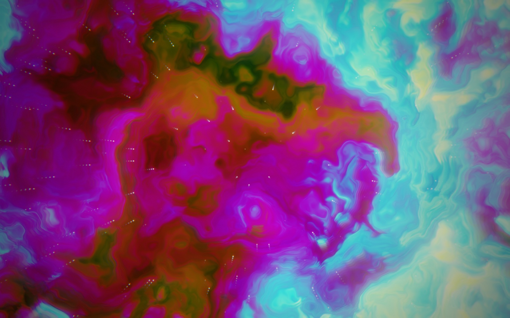 **1 · Nebula**<br>Domain-warped clouds that surge with the mix | 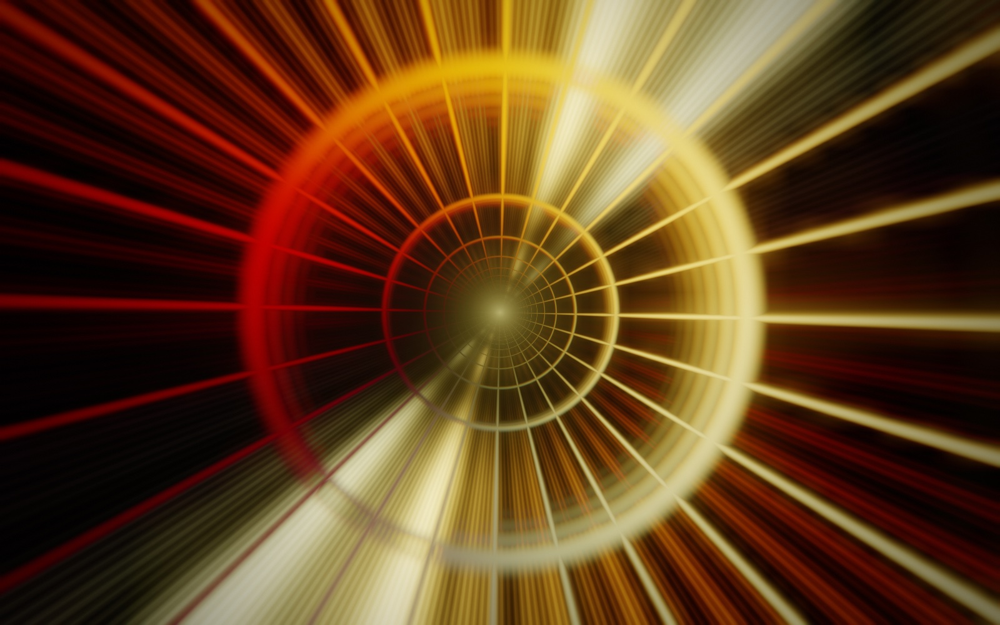 **2 · Tunnel**<br>Infinite tunnel with spectrum-lit walls | 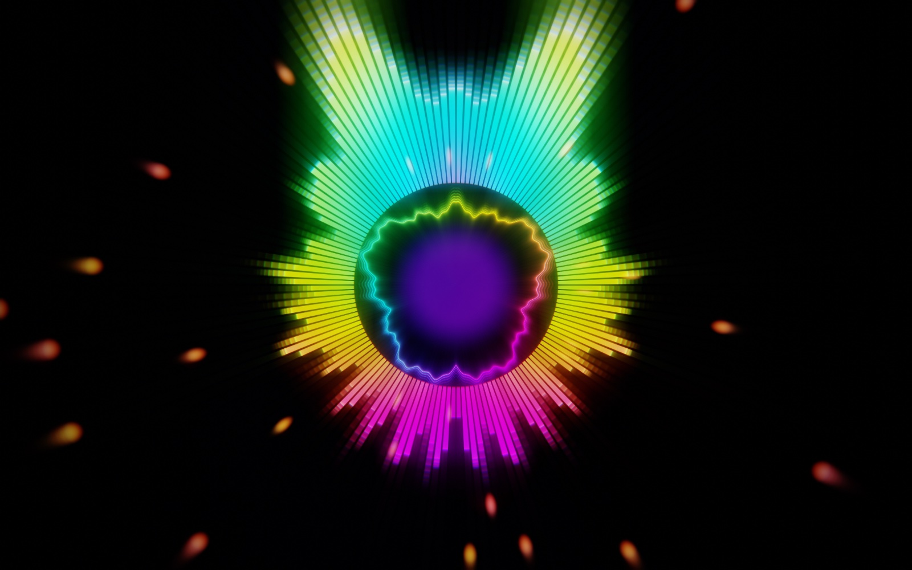 **3 · Radial**<br>Circular spectrum with a live waveform ring |
| 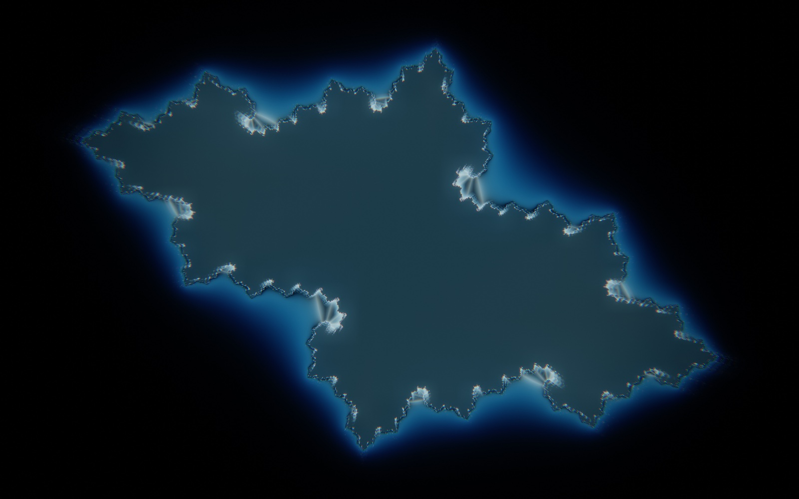 **4 · Julia**<br>A fractal whose shape is steered by bass and mids | 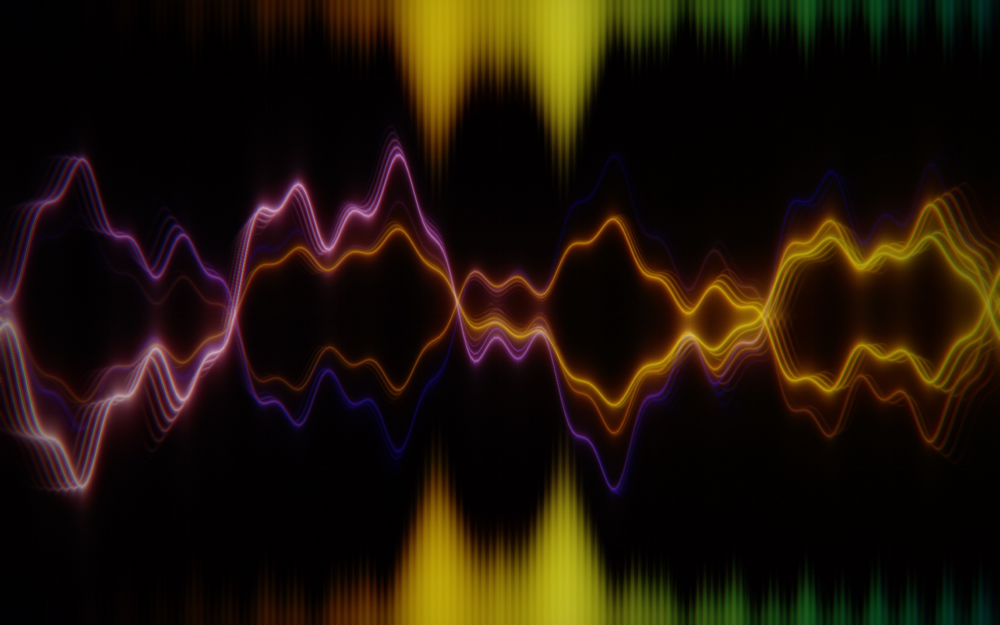 **5 · Oscilloscope**<br>Glowing, stabilised waveform with echoes | 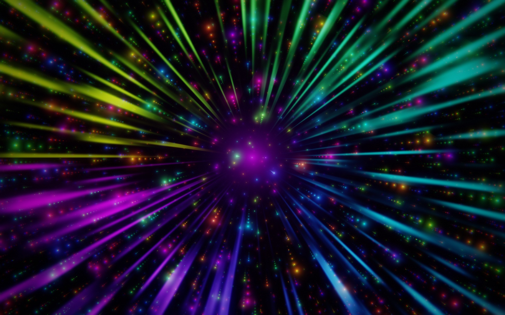 **6 · Hyperspace**<br>Starfield warp that accelerates on the beat |
| 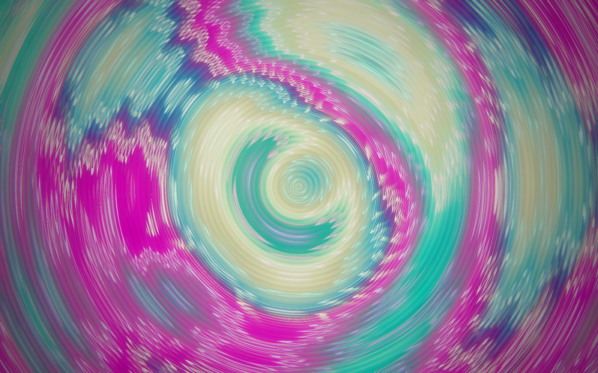 **7 · Plasma**<br>Classic demoscene plasma, spectrum-driven | 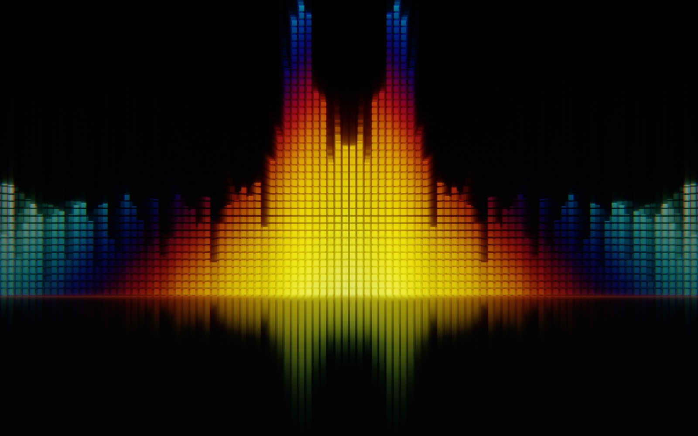 **8 · Equalizer**<br>LED bars mirrored on a reflective floor | 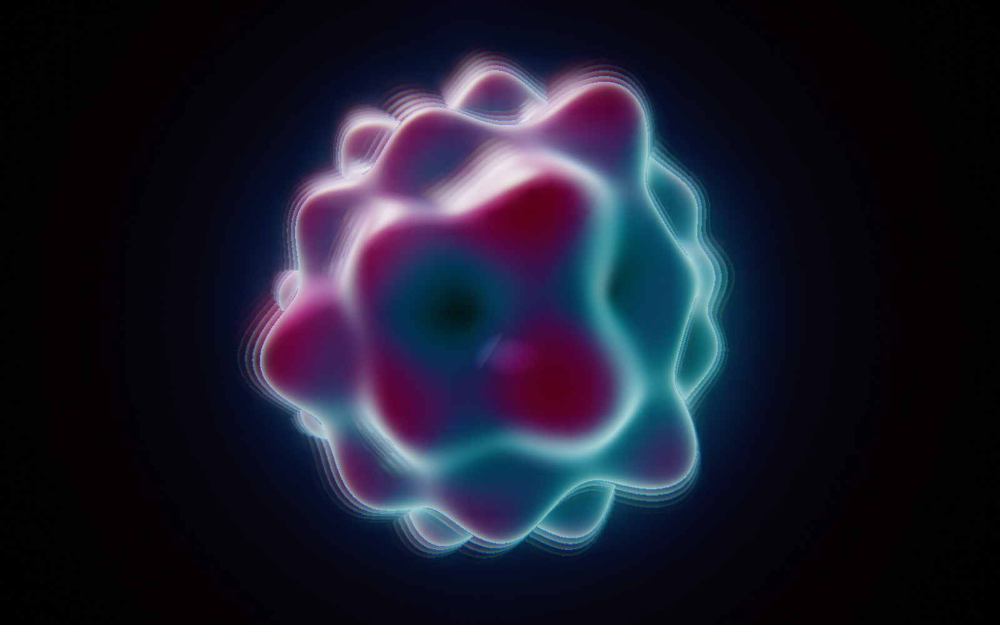 **9 · Orb**<br>Ray-marched 3D blob that deforms with the music |
| 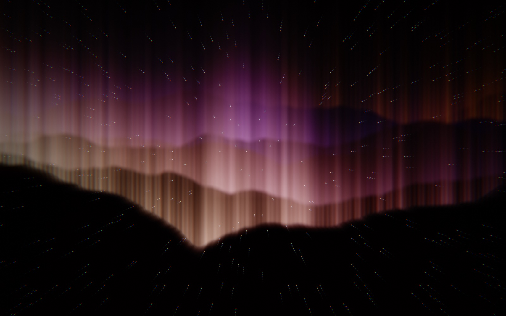 **0 · Aurora**<br>Northern-light curtains, one per frequency band | 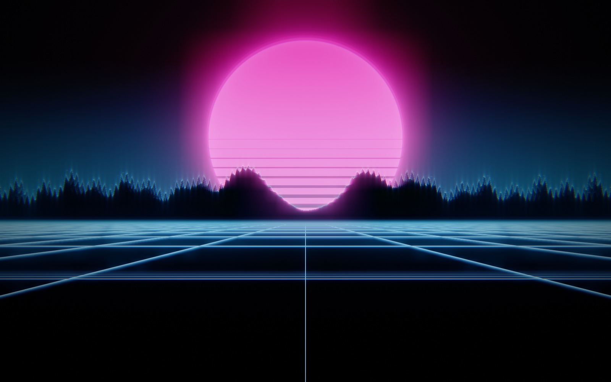 **Synthwave**<br>Retro sun, spectrum mountains, neon grid | |

### Effects that work on every scene

| Kaleidoscope (×6) | Feedback trails, zoom and spin |
|:-:|:-:|
| 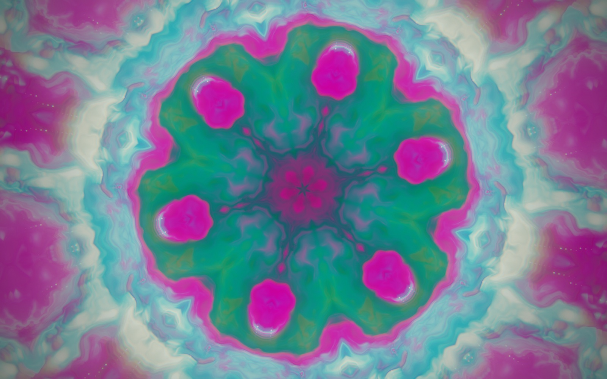 | 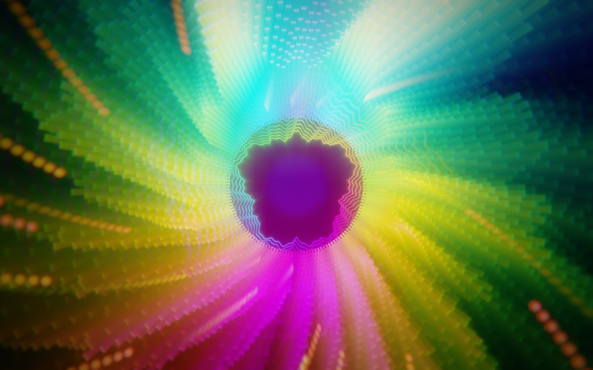 |

## Controls

The panel on the right holds every option. Press **H** to hide it; the cursor hides too.

| Section | Options |
|---|---|
| **Scene** | Scene, 11 colour palettes (they fade into each other), previous/next, 🎲 Randomize |
| **Auto-pilot** | Cycle scenes every N seconds, wait for a beat before switching, randomize everything on each switch |
| **Audio** | Sensitivity, smoothing, beat sensitivity, live bass/mid/treble meters |
| **Motion** | Speed (animation is also driven by loudness), shake on the beat |
| **Feedback** | Trails, zoom, spin, colour drift, kaleidoscope ×2 – ×12 |
| **Post-processing** | Bloom, chromatic aberration, flash on the beat, film grain, vignette, hue shift, hue cycling |
| **Display** | Render scale (lower it for performance), FPS counter, fullscreen, reset |

Settings are saved between launches.

### Keyboard

| Key | Action |
|---|---|
| `Space` / `→` | Next scene |
| `←` | Previous scene |
| `1` – `9`, `0` | Jump to a scene |
| `P` | Next palette |
| `R` | Randomize |
| `K` | Cycle kaleidoscope |
| `T` | Toggle trails |
| `A` | Toggle auto-pilot |
| `F` | Fullscreen |
| `H` | Hide / show panel |

## Build from source

Only the Xcode Command Line Tools are needed (`xcode-select --install`):

```bash
git clone https://github.com/SeifAteek/MacVisualiser.git
cd MacVisualiser
./build.sh
open build/Visualizer.app
```

Rebuilding changes the app's signature, so macOS may ask for the audio permission again.

## How it works

```
System audio ──► Core Audio process tap ──► ring buffer
                                               │
                         2048-pt FFT (Accelerate) ──► 256 log bands, bass/mid/treble, beat detection
                                               │
         Metal: scene shader ──► feedback pass (trails + kaleidoscope) ──► post pass (bloom, CA, grain…) ──► screen
```

- **Capture.** A Core Audio process tap (`CATapDescription`, macOS 14.2+) reads the system output directly. It needs no screen-recording permission and no loopback driver such as BlackHole.
- **Analysis.** A Hann-windowed FFT is mapped to 256 log-spaced bands (30 Hz – 16 kHz) with a +3 dB/octave tilt and auto-gain, so quiet and loud tracks both fill the screen. A beat is when bass energy jumps above its running average.
- **Rendering.** All visuals are fragment shaders in [`Sources/Shaders.metal`](Sources/Shaders.metal), compiled when the app starts. The feedback pass ping-pongs between two textures, Milkdrop-style. Bloom samples the mip chain, so it's wide and cheap.

| File | What's in it |
|---|---|
| [`Sources/Audio.swift`](Sources/Audio.swift) | System audio tap and the FFT / beat analyzer |
| [`Sources/Renderer.swift`](Sources/Renderer.swift) | Metal passes, scene crossfades, auto-pilot, palettes |
| [`Sources/Shaders.metal`](Sources/Shaders.metal) | All 11 scenes plus the feedback and post shaders |
| [`Sources/App.swift`](Sources/App.swift) | SwiftUI app, settings, control panel, keyboard shortcuts |

The screenshots above were rendered offscreen from the app's own shaders, using simulated music.

## Known limitations

- Switching audio output mid-session (e.g. connecting AirPods) may need an app restart.
- Apple Silicon only, and not notarized.
